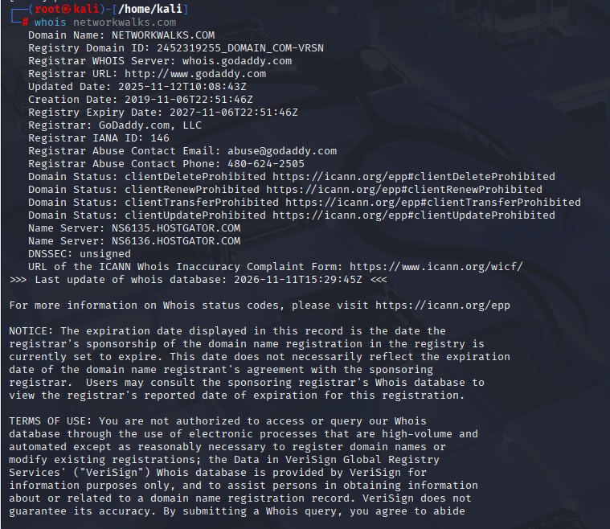
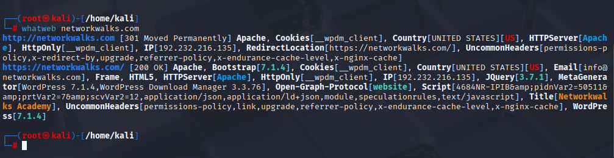
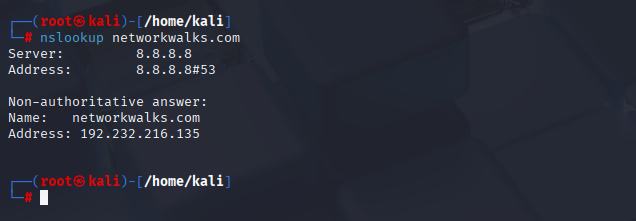
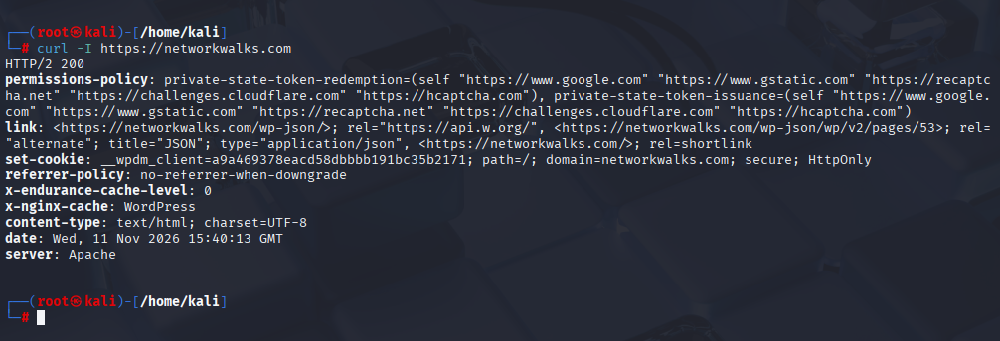
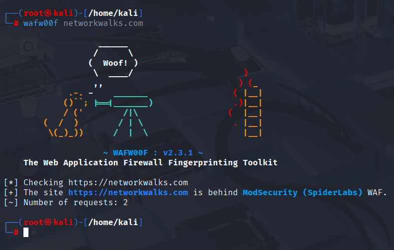
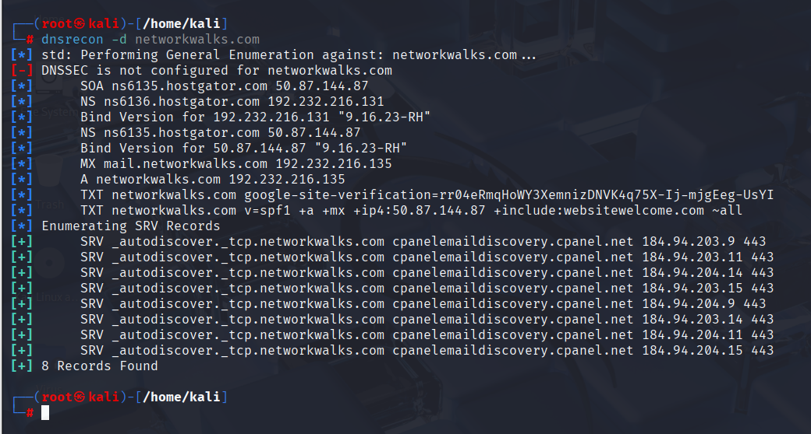

# PENETRATION TESTING REPORT
### FOOTPRINTING & NETWORK SCANNING PHASES
**W2-PM-FINAL | CYBERSECURITY | NETWORKWALKS**

| Pentester Name (Cybersecurity Professional) | Ayesha Akram Khan |
| :--- | :--- |
| Program / Batch | B084H - NetworkWalks |
| Date | 12 November 2026 |
| Modules completed | W2-PM1 (Multiple Kali Tools)   W2-PM5 (Zenmap Scanning) |
| Client / Target | 1. Networkwalks (secured written permission already)   2. My own local LAN Network |
| Permission secured from client? | Yes |
| Phases covered | Phase 1: Reconnaissance & Footprinting   Phase 2: Scanning & Network Discovery   Phase 3-5: In Progress |

---
## 1. Liability Disclaimer

This report is written only for learning and educational purposes as a part of my internship at NetworkWalks.

All the footprinting on networkwalks.com was done with the permission of NetworkWalks, for practice and learning. And all the scanning was done on my own home network and my own devices.

I did not try to access any system without permission, and I did not try to harm or damage any system.

Please do not use any command or method from this report to break the law or to access someone else's system without their permission. If anyone misuses this knowledge, they will be responsible for it themselves.

## 2. Introduction

In Week 2, I did two practical tasks for my internship at NetworkWalks.

In the first task, I did footprinting on networkwalks.com. I used different tools in Kali Linux to collect basic information about this domain, like who owns it, which server it is on, and which technologies are used on the website.

In the second task, I did scanning on my own home network. I used Zenmap on my Windows PC to find which devices are connected to my Wi-Fi, what are their IP addresses, and what are their MAC addresses.

The purpose of both tasks is to understand how an attacker first collects information about a target before doing anything else. In this report, I have written the command I used, what result I got, and my screenshot as proof for every step.

---

## 3. Tools Used

In this report, I used the following tools:

| Tool | Why I Used It |
| :--- | :--- |
| Kali Linux & Windows | For running all the commands and tools |
| WHOIS | To check domain registration and name server details |
| whatweb | To find which CMS and technologies the website is using |
| nslookup | To find the IP address of the domain |
| curl -I | To see the HTTP headers of the website |
| wafw00f | To check if the website has a firewall or WAF |
| dnsrecon | To find DNS records like MX, TXT and name servers |
| Zenmap (Nmap GUI) | To scan my own network and find live devices |
| Windows CMD | To check my own IP address and subnet |

## 4. Activities Performed

### 4.1 Footprinting & Reconnaissance

In this part, I did footprinting on networkwalks.com with the permission of NetworkWalks. I used 6 tools in Kali Linux, and every tool gave me a different type of information.

**1. WHOIS**
I used WHOIS to check the domain registration details and name servers of networkwalks.com.

Command: `whois networkwalks.com`

**2. WhatWeb**
I used WhatWeb to check which technologies and CMS the website is using.

Command: `whatweb networkwalks.com`

**3. Nslookup**
I used Nslookup to find the IP address of networkwalks.com.

Command: `nslookup networkwalks.com`

**4. Curl**
I used Curl with `-I` to see the HTTP headers of the website.

Command: `curl -I https://networkwalks.com`

**5. Wafw00f**
I used Wafw00f to check if the website is protected by any WAF / Firewall.

Command: `wafw00f networkwalks.com`

**6. DNSRecon**
I used DNSRecon to find all the DNS records of the domain.

Command: `dnsrecon -d networkwalks.com`

### 4.2 Network Scanning with Zenmap

In this part, I scanned my own home network with Zenmap / Nmap.

First, I checked my own Windows IP in command prompt. Then I put my own subnet in Zenmap and did a Ping Scan to find live devices in my network.

Command: `nmap -sn <my-subnet>`

The scan showed me which devices were live in my own network, along with their IP and MAC addresses.

## 5. Risk Analysis / Impact

I did only information gathering. I did not do any exploitation or vulnerability testing. 

### 5.1 Footprinting Risks - networkwalks.com

| # | Tool | What I Found | Why It Is Risky | Risk |
| :--- | :--- | :--- | :--- | :--- |
| 1 | whatweb | Website is using WordPress and WP Download Manager, versions are visible | Attacker can search for known problems in that specific version | Medium |
| 2 | nslookup | Domain IP address is visible | Attacker can find the hosting location and target that server | Low |
| 3 | curl -I | HTTP headers and /wp-json/ details are visible | Attacker gets extra technical information for fingerprinting | Low |
| 4 | wafw00f | Website is protected by ModSecurity WAF | Attacker now knows which WAF to try to bypass | Low |
| 5 | dnsrecon | DNS records like NS, MX, TXT, SPF are visible | Attacker can make a complete map of the domain infrastructure | Medium |

### 5.2 Scanning Risk - My Own Network

| # | Tool | What I Found | Why It Is Risky | Risk |
| :--- | :--- | :--- | :--- | :--- |
| 6 | Zenmap / Nmap | Many live hosts are visible in my own network | If any unknown device is connected, it can be used to attack my network | Medium |

---

## 6. Recommendations

### 6.1 For Footprinting - Website Security

1. **Hide version details** - WordPress and plugin versions should not be shown publicly.
2. **Keep software updated** - WordPress, themes and plugins should be updated regularly.
3. **Clean HTTP headers** - Only required information should be shown in headers.
4. **Review DNS records** - Only required DNS records should be kept public.
5. **Keep WAF ON and updated** - ModSecurity should stay enabled, updated and monitored.

### 6.2 For Scanning - Network Security

6. **Scan your network regularly** - Use Nmap to check which devices are connected.
7. **Investigate unknown devices** - If any device you don't know appears, check it and block it if needed.
8. **Maintain a device list** - Keep a written record of your own devices with their IP and MAC addresses, so you can easily find an unknown one.

   ## 7. Conclusion

In Week 2, I learned how the first step of ethical hacking works - information gathering.

In the footprinting task, I collected public information about networkwalks.com using 6 different tools in Kali Linux. I learned that even small public details like IP address, DNS records, HTTP headers, WAF and CMS version can help an attacker understand the target.

In the scanning task, I scanned my own home network using Zenmap / Nmap. I learned how to find live devices in my own network and how to see their IP and MAC addresses.

Both tasks helped me understand that before any attack, an attacker first collects information. As a defender, if we know what information is visible about us, we can secure it better.

I completed both tasks with permission, only for learning purposes, and I did not do any exploitation.

---

## 8. Evidence / Screenshots

All screenshots below are my own work, taken during the tasks. They are attached as proof of each step.

My linkedin post link for week 2 project is:

https://www.linkedin.com/posts/aisha-khan-082446376_cybersecurity-ethicalhacking-footprinting-share-7526608529214894080-Gqpt?utm_source=social_share_send&utm_medium=android_app&rcm=ACoAAFz4POIBuzLy4HLMi1c6CZ4TJx4PEOMETqc&utm_campaign=whatsapp

